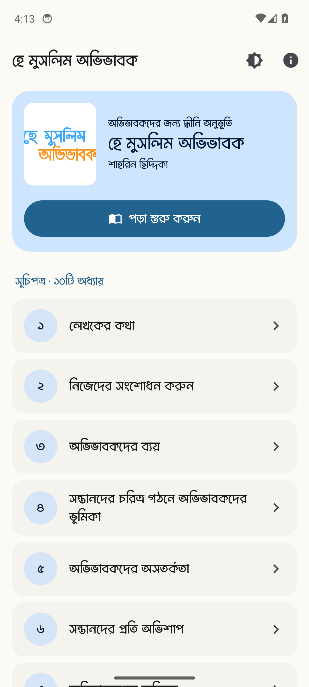
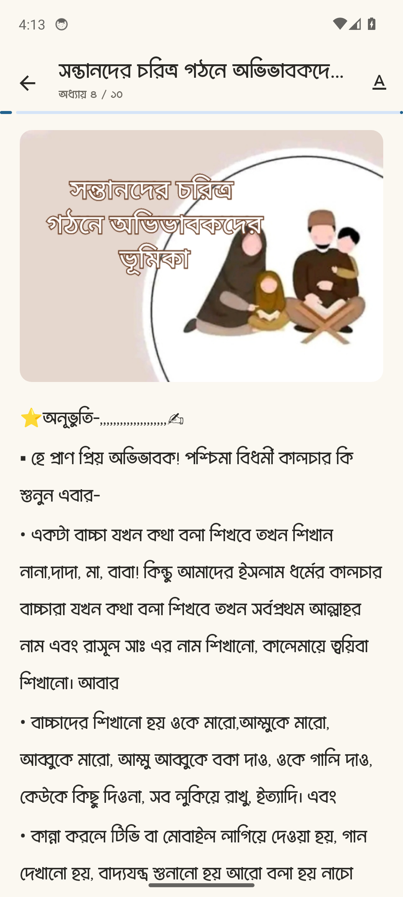
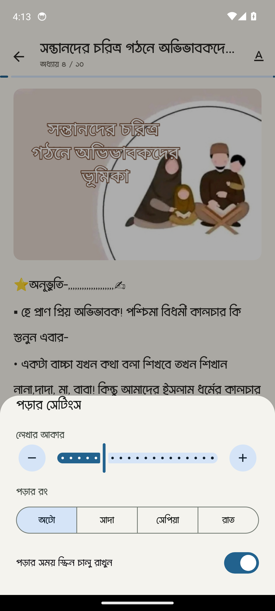
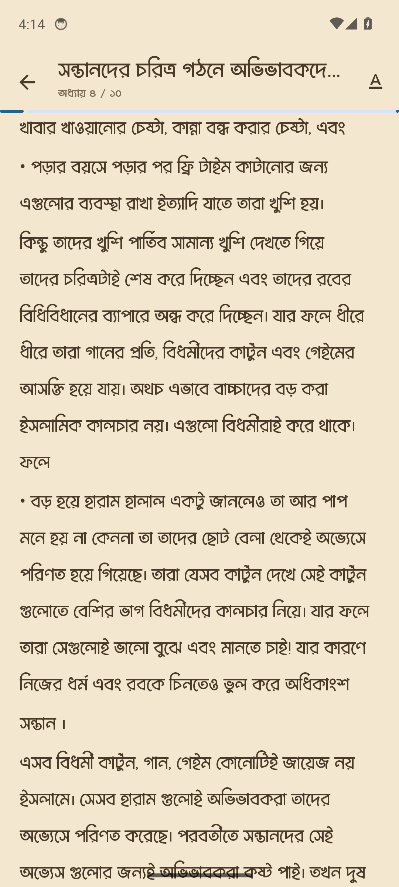

<div align="center">

# হে মুসলিম অভিভাবক

**অভিভাবকদের জন্য দ্বীনি অনুভূতি — লেখিকা শাহরিন ছিদ্দিকা**

A Bengali Islamic book on parenting, turned into a calm, easy-to-read Android ebook.
It works completely offline, with no ads and no account.

[](../../releases/latest)
[](../../actions/workflows/ci.yml)
[](#install)
[](#how-its-built)

[**Download the APK**](../../releases/latest) · [Report a problem](../../issues/new)

<br />


&nbsp;

&nbsp;


</div>

---

## বইটি সম্পর্কে · About the book

**হে মুসলিম অভিভাবক** is a book by **শাহরিন ছিদ্দিকা** for Muslim parents: on their own self-improvement,
on spending for the family, and on the part parents play in shaping their children's character. It has
**১০টি অধ্যায় (10 chapters)**, starting with the author's own note, লেখকের কথা.

The app's job is simple: get out of the way and let people read. The text uses a proper Bangla font,
chapter numbers are in Bangla numerals, and the reader remembers where you stopped.

## Features

- **Read offline.** The whole book ships inside the app. It doesn't even ask for internet permission.
- **Pick up where you left off.** The home screen shows a "continue reading" card for the last chapter you opened.
- **Comfortable reading.** Adjust the text size from 80% to 180%, and choose a light, sepia or dark page.
- **Reading progress.** A progress bar at the top of every chapter, and chapters you've finished are marked as read.
- **Light and dark theme** for the whole app, with a quick toggle on the home screen.
- **About the writer.** A page introducing the author, plus an about screen for the app.

## Screenshots

| Home | Chapter | Reader settings | Sepia page | Dark page |
|:---:|:---:|:---:|:---:|:---:|
|  |  |  |  |  |

## Install

1. Open the [latest release](../../releases/latest) on your Android phone.
2. Download `app-release-signed.apk` and open it.
3. If Android asks, allow installs from your browser or file manager.

Works on Android 7.0 (API 24) and newer.

## How it's built

| | |
|---|---|
| **Language** | Java |
| **UI** | Material 3 (Material Components 1.14), Navigation component, fragments |
| **Book content** | One HTML file per chapter in `assets/chapter/`, styled with local CSS and an embedded Bangla font |
| **Storage** | SharedPreferences for the last chapter, text size and page colour |
| **Android** | min SDK 24, target SDK 36 |
| **CI / releases** | GitHub Actions tests every pull request and feature branch; each push to `main` runs the tests again, builds a signed APK and AAB, and publishes a GitHub Release |

```text
app/src/main/
├── assets/
│   ├── chapter/        1.html … 10.html — the book
│   ├── images/         chapter cover images
│   └── css/  font/     reader styles and the Bangla font
└── java/com/toufikhasan/heamoslimovivabok/
    ├── MainActivity, ChapterViewActivity
    ├── data/           chapter list, reading preferences
    ├── ui/             home, writer and about screens
    └── util/           Bangla digits, reading progress, cover loading
```

## Build from source

You'll need Android Studio (latest stable) and JDK 17.

```bash
git clone https://github.com/toufikforyou/hea-muslim-ovivabok-book-app.git
cd hea-muslim-ovivabok-book-app

./gradlew assembleDebug        # build a debug APK
./gradlew testDebugUnitTest    # run the unit tests
```

## Credits

- **Book:** শাহরিন ছিদ্দিকা (Shahrin Siddeka). The book's text belongs to the author.
- **App:** designed and built by **MH TOUFIK** · [@toufikforyou](https://github.com/toufikforyou) · [toufikforyou.dev](https://www.toufikforyou.dev)
